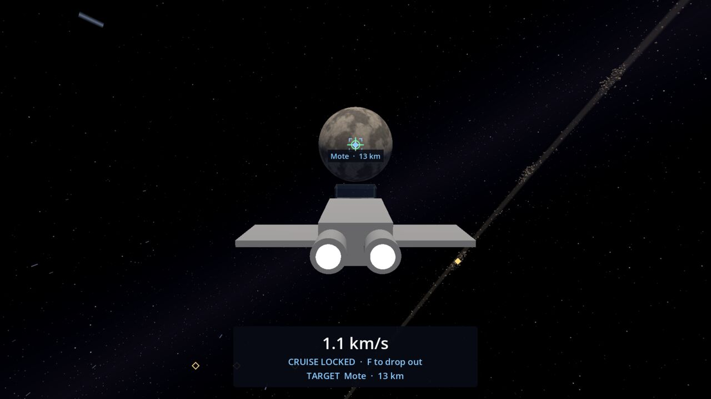

# Cruise Drive

The cruise drive is how you cross the solar system: it flies far faster than the engines can, slows down by itself
as you near something, and drops you out when you arrive. A trip across the whole system takes about half a minute.

## Fly to a place (lock on)

1. Put the nose on a place's marker (or anywhere on a planet's or moon's disc). The marker is framed in corner
   brackets and the HUD says, for example, **F  Cruise to Mote**.
2. Press **F**. The drive charges for 2 seconds while you fly normally, then takes over.
3. Sit back. The ship turns to face the place and flies there by itself, going round any planet, moon or station in
   the way. The place's marker turns blue, the HUD reads "CRUISE LOCKED · F to drop out" and the dashboard shows the
   target, how far it is and how long until you get there, for example "TARGET  Mote · 16 km · 18 s".
   The time counts down as you go and is checked again every second, so a detour round a planet is
   counted in. Trips longer than ten minutes show no time.
4. It drops out when you arrive, at 200 m/s, and flight assist holds that speed.

Going to Tollgate, it flies past Calder without stopping. If it can see the base well above the horizon it flies
straight at it; from low down or the far side of Calder it goes round the planet first and comes down at it from above.

Move the mouse to take the steering back ("Lock released · steering yourself"). The drive then carries on wherever
the nose points. Rolling with Q and E doesn't release the lock.

## Cruise where the nose points

Press **F** with nothing aimed at and the drive goes wherever the nose points; you steer with the mouse. It drops out
by itself when you arrive at any place.

## Dropping out

- **F** drops out at once and keeps a cruising speed of 200 m/s.
- **X** drops out and brings the ship to a stop.
- It drops out by itself if it would reach a surface within 2.5 seconds (slowing you to 50 m/s), or if you bump into
  something. It never flies you into anything.

## When it won't start

The drive won't start inside the asteroid belt, among Tollgate's buildings, or with the nose pointing at something
you would hit within 5 seconds. A message on screen says what is in the way. It also can't lock onto a place you are
already at.

## Speeds

| | |
| --- | --- |
| Charge time | 2 s |
| Speed | 300 m/s close to things, up to 5 km/s in open space |
| Speed after dropping out | 200 m/s (50 m/s after a safety drop) |

In cruise the space dust you normally see is replaced by a coarser cruise dust, so you can still feel the speed.
