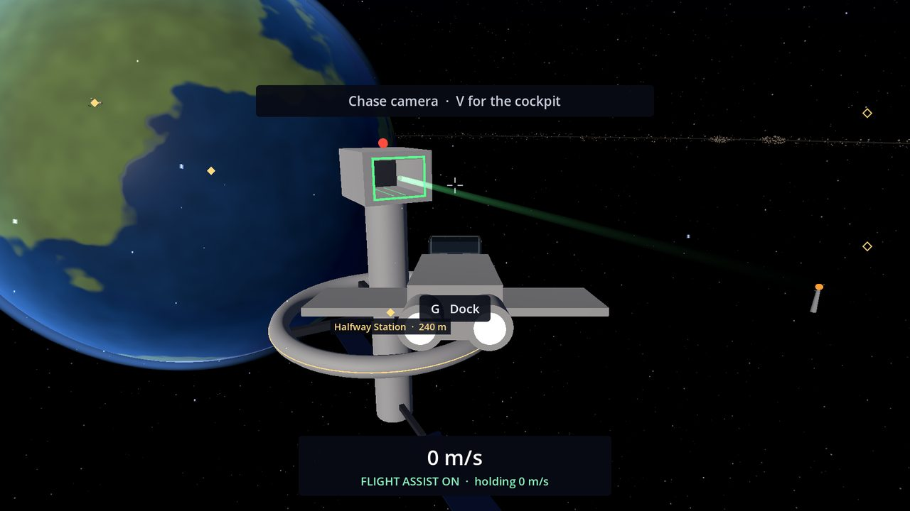
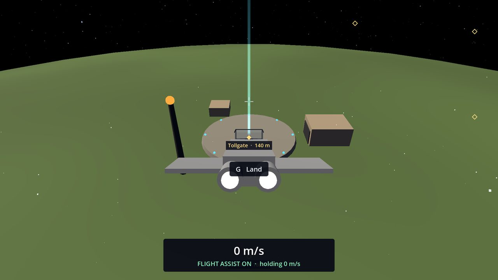
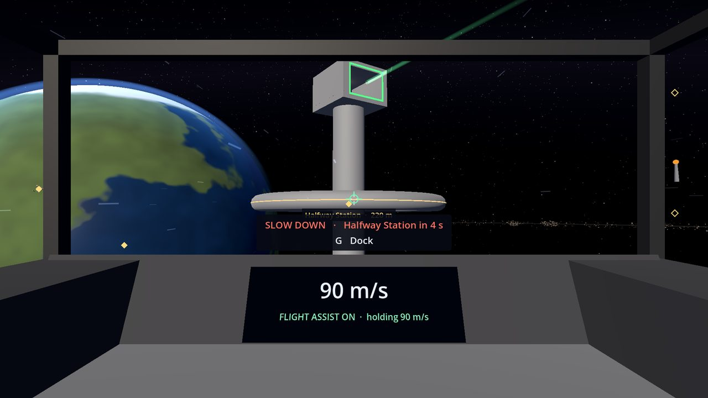

# Docking and Landing

Docking at a station and landing at a base work the same way: get close, slow down, press **G**, and your ship's
docking computer flies you in while you watch. There are no loading screens and the camera never cuts away.

## Guide lights

Every place you can dock or land shines a faint light to line up with. Halfway Station's bay has a soft green beam
coming straight out of its mouth along the way in. Tollgate's pad has a thin cyan beam going straight up. The beam gets
a little brighter when you're lined up with it, and while the ship is flying itself in. You can fly all the way in by
hand along the beam, but you still press **G** to dock or land.

## Docking at Halfway Station

1. Fly toward Halfway Station. From about 3.5 km the HUD tells you what to do next: "Fly within 1.5 km to dock
   (2.3 km)", then "Slow below 100 m/s to dock".
2. When it shows **G  Dock**, press **G**.
3. The ship flies round the station to the front of its docking bay (the opening with the green frame and the green
   beam), lines up and eases in nose first. Inside, it turns round so you look out of the bay's mouth, then settles
   gently down onto the bay's floor.
4. The HUD says "Docked at Halfway Station · Game saved".

The docking computer carries on at about the speed you were going when you pressed **G**. It slows down as it needs
to, but never races off much faster than you were flying. From the edge of the docking zone at 80 m/s it takes about
40 seconds; from there at 10 m/s, nearer a minute. Flying closer before pressing **G** makes it shorter. If you've
already flown into the bay and are close to its floor, **G** brings the ship in low, without climbing first.

**G** again undocks: the ship lifts gently off the floor, is eased straight out of the bay and handed back to you at
25 m/s.

## Landing at Tollgate

Tollgate is the base on the planet Calder, on the side facing the station.

1. Head for Tollgate (the cruise drive drops you out about 4 km away). The HUD says "Fly within 600 m to land
   (1.3 km)" until you're close to the pad.
2. Within 600 m of the pad, slower than 100 m/s, the HUD shows **G  Land**. Press **G**. Landing isn't offered from
   orbit or from high above the base: fly down to the pad first.
3. The ship flies to a point above the landing pad (at least 120 m up, to clear the tower), then comes straight down
   onto the pad, facing the hangar, and touches down softly.
4. The HUD says "Landed at Tollgate · Game saved".

From the edge of the landing zone this takes about 20 to 30 seconds.

**G** again takes off: the ship rises 30 m straight up off the pad, then hovers with flight assist on.

## Too fast: SLOW DOWN

Flying by hand, the HUD shows a red warning, for example "SLOW DOWN · Halfway Station in 4 s", when you're heading at
something faster than you could comfortably stop. It names what's in the way (a station, base, planet, moon or the
belt) and how many seconds until you reach it at this speed. At 100 m/s it warns you about 500 m out; below 6 m/s it
stays quiet. Brake (**S**) or turn away and it goes.

## Taking back the controls

- **G** on the way in cancels and hands the ship straight back to you, moving as it was. On the last stretch into the
  bay or down to the pad, it brings the ship to rest instead of carrying on.
- **X** cancels and brings the ship to a full stop.
- A bump on the way stops it too ("Bump! Docking stopped. G to try again") and the ship comes to rest.

Nothing is offered while the cruise drive is charging or running: drop out first (**F**).

## Not yet

Mote has no landing site yet; landing there comes with surface mining. See the [Roadmap](Roadmap).
