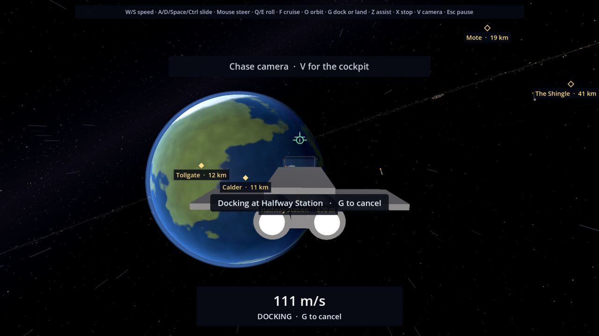
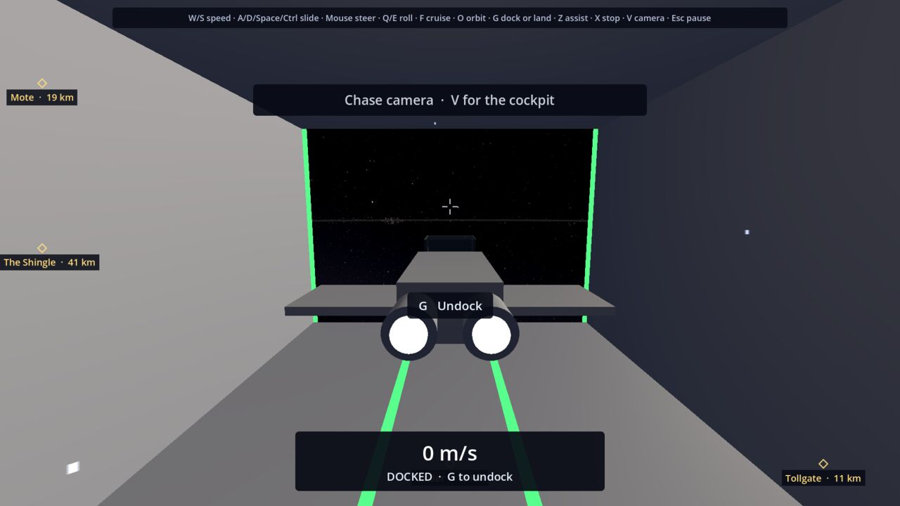
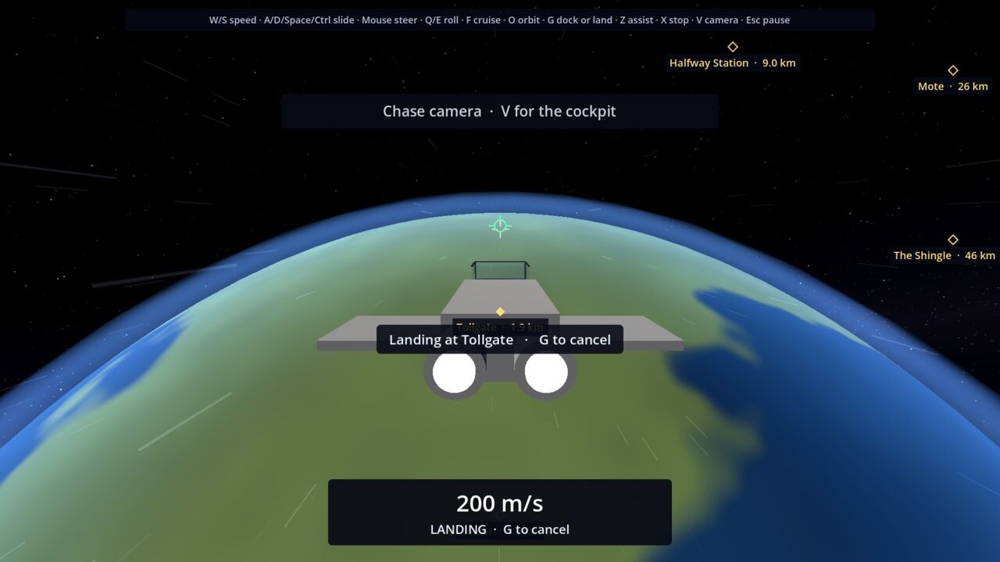

# Docking and Landing

Docking at a station and landing at a base work the same way: get close, slow down, press **G**, and your ship's
docking computer flies you in while you watch. There are no loading screens and the camera never cuts away.

## Docking at Halfway Station

1. Fly toward Halfway Station. From about 3.5 km the HUD tells you what to do next:
   "Fly within 1.5 km of Halfway Station to dock", then "Slow below 100 m/s to dock at Halfway Station".
2. When it shows **G  Dock at Halfway Station**, press **G**.
3. The ship flies round the station to the front of its docking bay (the opening with the green frame), lines up,
   and eases in nose first. Inside, it turns round and settles onto its berth, so you look out of the bay's mouth.
4. The HUD says "Docked at Halfway Station · Game saved".

From the edge of the docking zone this takes about 30 to 40 seconds. Flying closer before pressing G makes it shorter.

**G** again undocks: the ship is eased straight out of the bay and handed back to you at 25 m/s.

## Landing at Tollgate

Tollgate is the base on the planet Calder, on the side facing the station.

1. Come within 4 km of Calder's surface, anywhere round the planet (orbit counts), slower than 100 m/s.
2. When the HUD shows **G  Land at Tollgate**, press **G**.
3. The ship flies to a point high above the landing pad, going round the planet if it needs to, then comes straight
   down onto the pad, facing the hangar, and touches down softly.
4. The HUD says "Landed at Tollgate · Game saved".

Landing from orbit takes about 30 to 45 seconds; from the far side of Calder about 80 seconds.

**G** again takes off: the ship rises 30 m straight up off the pad, then hovers with flight assist on.

## Taking back the controls

- **G** on the way in cancels and hands the ship straight back to you, moving as it was.
- **X** cancels and brings the ship to a full stop.
- A bump on the way stops it too ("Bump! Docking stopped. G to try again") and the ship comes to rest.

Nothing is offered while the cruise drive is charging or running: drop out first (**F**).

## Not yet

Mote has no landing site yet; landing there comes with surface mining. See the [Roadmap](Roadmap).
