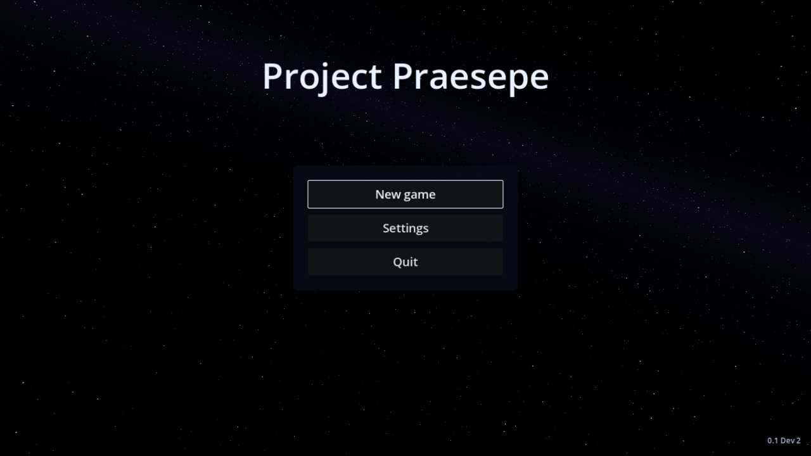
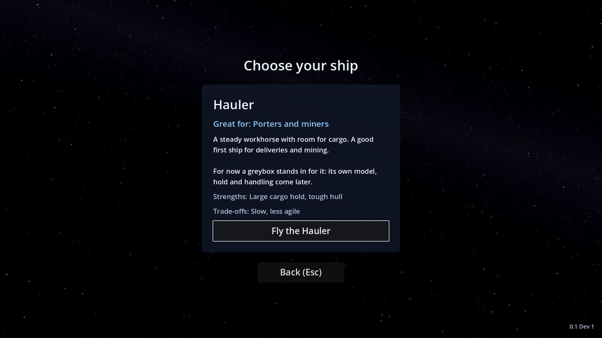

# Getting Started

There is no download yet (see the [FAQ](FAQ#is-there-a-download)). Once there is, this is your first flight.

## Your first flight

1. **The title screen.** The game opens fullscreen on the start menu: **Continue** (once you have a saved game),
   **New game**, **Settings** and **Quit**.

   

2. **Choose your ship.** **New game** shows the ships you can start with, each with a "Great for" hint. For now there
   is one, the Hauler (great for porters and miners). Press **Fly the Hauler**.

   

3. **The start.** You begin docked in Halfway Station's bay, looking out of its mouth at the planet Calder, and the
   game saves straight away. A short message says where to find the controls: Esc, then **Settings**, then
   **Controls**. Press **G** to undock: the ship eases out of the bay and hands you the controls.
4. **Get moving.** Hold **W** to speed up and let go: flight assist holds your speed. **S** slows down. Move the mouse
   to steer and **Q** / **E** to roll. The small marker on screen (the velocity marker) shows where the ship is really
   going. More on the [Flying](Flying) page.
5. **Look around.** Press **V** for the chase camera behind the ship, and **V** again for the cockpit.
6. **Dock at the station.** Fly toward Halfway Station's marker and slow down. When the HUD shows
   **G  Dock**, press **G** and your ship flies itself into the docking bay. **G** again undocks. See
   [Docking and Landing](Docking-and-Landing).
7. **Cruise somewhere.** Put the nose on a place's marker (try Mote, the moon) until it is framed in corner brackets
   and the HUD says **F  Cruise**, then press **F**. After a two-second charge the cruise drive flies you there
   by itself and drops out when you arrive. See [Cruise Drive](Cruise-Drive).
8. **Park in orbit.** Head for Calder and climb to its orbit line, 3 km up: once you're off the ground a ring on the
   HUD shows where to join it. Close to the line, press **O** when the HUD offers it to circle the planet and enjoy
   the view. See [Orbit](Orbit).
9. **Land.** Fly to Tollgate, Calder's base, and follow its cyan guide light down. Within 600 m of the pad the HUD
   offers **G  Land**: press **G** and the ship flies down onto the pad.

The game saves itself every time you dock or land, every 3 minutes while you fly, and when you quit. Next time, press
**Continue** on the start menu and you are back exactly where you saved: in the bay, on the pad, in orbit or out in
space, facing the same way.

## If you get lost

- Every place has a diamond marker on screen, and its name and distance show when you are close, looking toward it or
  aiming at it.
- **X** brings the ship to a full stop at any time.
- **Esc** pauses the game. Switching to another window pauses it too.
- Far from anywhere? Pause and press the tow button ("Tow me to Halfway Station · free") twice: your ship is put straight back at the last station or
  base you docked or landed at.

## What comes next

Jobs, money, the ship loan and upgrades are not in the game yet. The [Roadmap](Roadmap) says what is coming.
