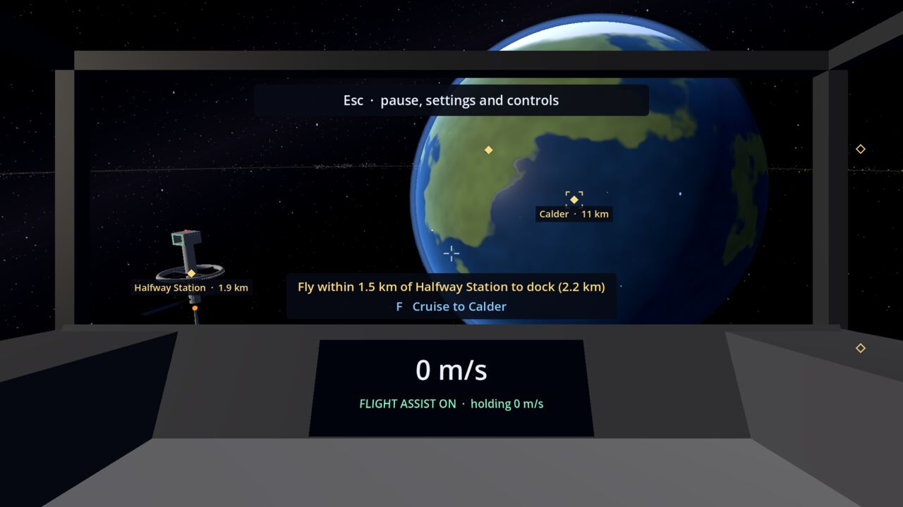

# Project Praesepe

**Project Praesepe** (a working title) is a relaxed, first-person space game for Windows PCs. You buy a ship on a
simple loan, then earn money flying jobs around one hand-built solar system: hauling cargo, mining asteroids, ferrying
passengers and more. No survival meters, no crafting, nothing that wipes your progress. Just you, your ship and the
next job.

## Where the game is now

The game is in **early development** and there is **no download yet**. What you can do in the current build:

- Fly a test ship with weighty, Newtonian flight and flight assist ([Flying](Flying)).
- Cruise between places at up to 5 km/s, or aim at a place and let the ship fly you there ([Cruise Drive](Cruise-Drive)).
- Dock at Halfway Station and land at Tollgate, with the ship flying itself in, no loading screens
  ([Docking and Landing](Docking-and-Landing)).
- Climb to the orbit line round the planet Calder or its moon Mote and park there ([Orbit](Orbit)).
- Visit five places: Calder, Tollgate, Mote, Halfway Station and the asteroid belt The Shingle ([Locations](Locations)).

The game saves itself as you play, and a tow takes you home if you get lost. There are no jobs, money or upgrades
yet. Those come next: see the [Roadmap](Roadmap).

## Start here

- [Getting Started](Getting-Started): your first flight, step by step.
- [Controls](Controls): every key.
- [Settings and Accessibility](Settings-and-Accessibility): display, interface, comfort and mouse settings.
- [FAQ](FAQ): saves, known issues and common questions.
- [Patch Notes](Patch-Notes): what changed, newest first.

## About this wiki

This wiki follows the newest development build: when something in the game changes, the page that describes it is
updated in the same change. Anything still being built is on the [Roadmap](Roadmap), never described here as if you
can play it. Names of places and ships are placeholders and may change. Pictures are rough captures of the development build,
with simple stand-in models, not how the finished game will look.
