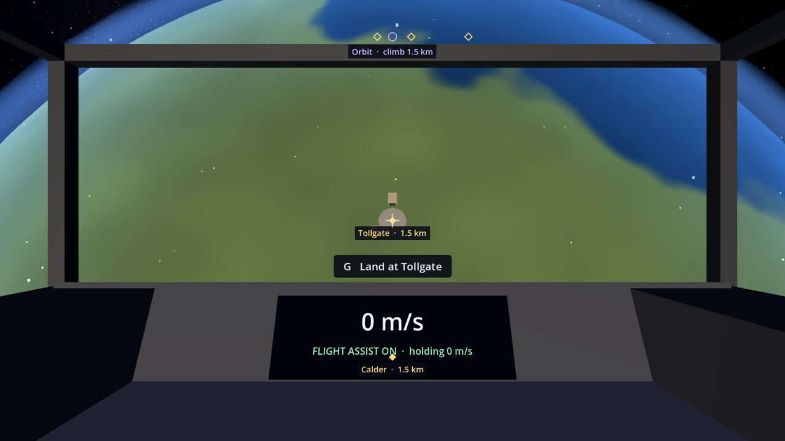
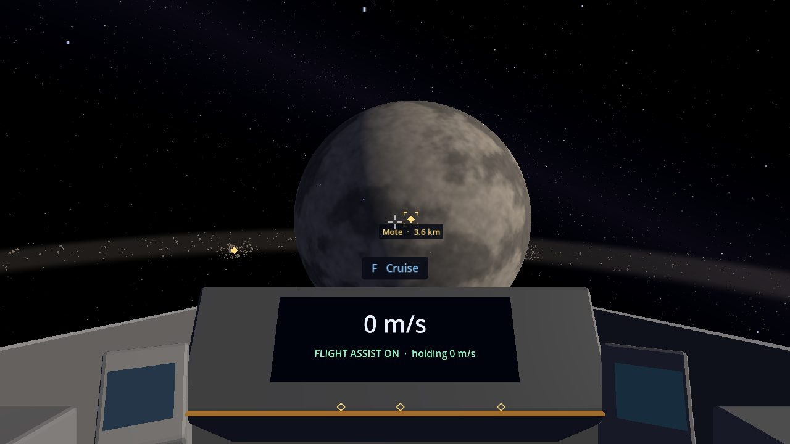
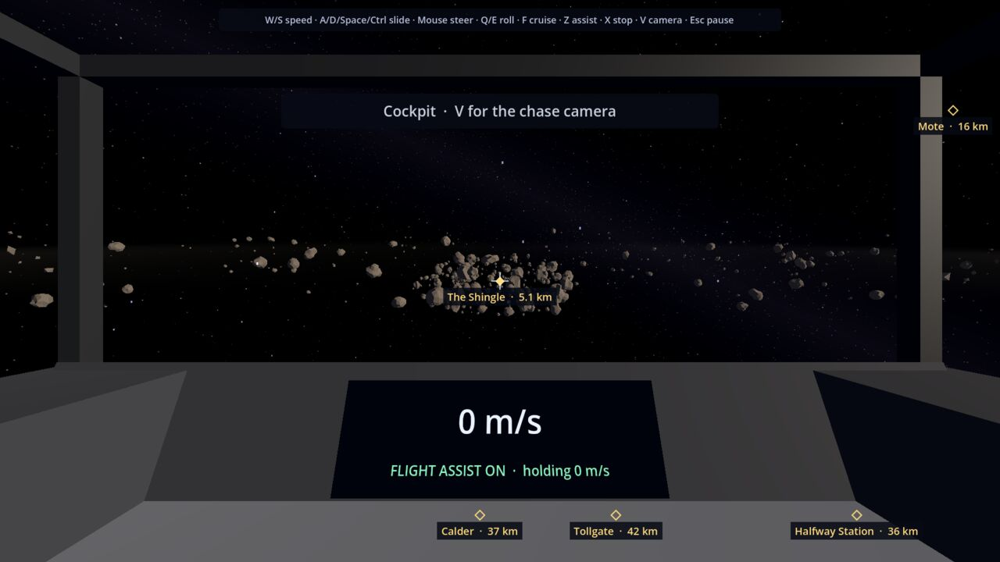

# Locations

Everything happens in one hand-built solar system, shrunk down so travel never drags. The current build has one
planet with a base, one moon, one space station and one asteroid belt, lit by the star **Sorrel**. All the names are
placeholders. Nothing orbits yet: the planet, moon and station hold still.

| Place | What it is | Where |
| --- | --- | --- |
| [Calder](#calder) | The planet | The middle of the system |
| [Tollgate](#tollgate) | Calder's base | On Calder's surface, facing the station |
| [Halfway Station](#halfway-station) | The space station | 10 km above Calder |
| [Mote](#mote) | Calder's moon | 31 km from Calder |
| [The Shingle](#the-shingle) | The asteroid belt | A ring 50 km out round Calder |

The quickest way between them is the [Cruise Drive](Cruise-Drive): aim at a place's marker and press F.

## Sorrel

The star. It is the light and the bright disc in the sky, not somewhere you can fly to.

## Calder

A blue planet with seas, green land, ice caps and a thin blue glow of air, 6 km in radius. Its orbit line is 3 km up, where you
can park and circle it ([Orbit](Orbit)), and land at its base, Tollgate, from anywhere within 4 km of its surface.

## Tollgate

Calder's base: a landing pad with a hangar, a control tower and a beacon. Press G near Calder to land on its pad
([Docking and Landing](Docking-and-Landing#landing-at-tollgate)). Landing saves the game.

Services: none yet. Jobs, trading and loan payments will be here (see the [Roadmap](Roadmap)).

## Halfway Station

A space station of a long spine, a ring and solar panels, with an open docking bay on top framed in green. It hangs
10 km above Calder, and it is where you start: 2 km away, with three buoys marking the way in. Press G nearby to dock
([Docking and Landing](Docking-and-Landing#docking-at-halfway-station)). Docking saves the game.

Services: none yet.

## Mote

Calder's small moon: grey and airless, 1.5 km in radius, sitting above the plane of the belt. Its orbit line is 1.2 km up,
where you can park and circle it. There is nowhere to land on it yet.

## The Shingle

An asteroid belt circling Calder, 50 km out, 6 km wide and 800 m thick. It is made of thousands of rocks, from 30 m
to 220 m across, scattered round the ring with ten dense clusters. Its marker points to the first cluster, on the
belt's inner edge.

The rocks are different for every world seed and the same every time you play the same seed. You can bump into the
rocks near you. The cruise drive won't start inside the belt, so fly out of it first.

