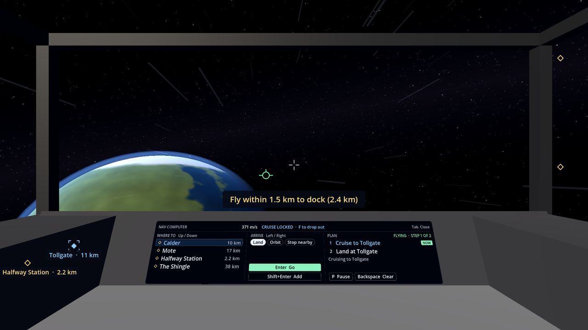
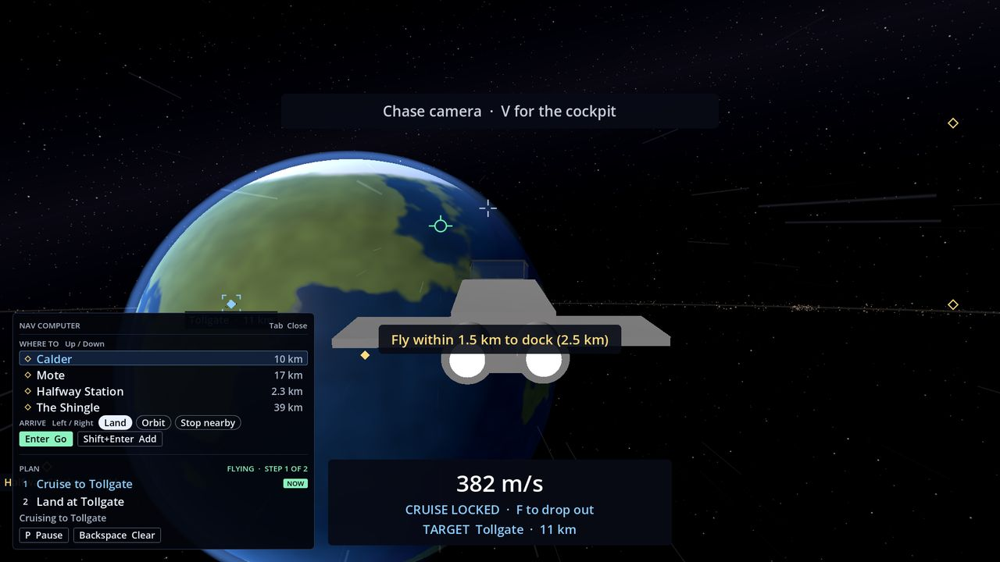

# Nav Computer

The nav computer flies trips for you. Pick a place and how you want to arrive, and the ship undocks, cruises there and
docks, lands or settles into orbit by itself. You can line up several trips in a row.

## Opening it

Press **Tab**. In the cockpit it lights up on the dashboard, over the speed screen, and its top line shows your speed
and flight assist instead. The mouse is let go so you can click it. In the chase camera the same screen shows as a
card in the bottom left corner. **Tab** again closes it and gives the mouse back. The ship keeps flying while it is
open.

## Giving an order

1. **Where to:** pick a place with **Up** and **Down**, or click it: Calder, Mote, Halfway Station or The Shingle.
   Each shows how far away it is. Tollgate is under Calder.
2. **Arrive:** pick how to arrive with **Left** and **Right**, or click it:
   - **Dock** at Halfway Station.
   - **Land** at Tollgate (pick Calder).
   - **Orbit** round Calder or Mote.
   - **Stop nearby:** cruise there and drop out.
3. **Enter Go** flies it now, replacing anything already planned. **Shift+Enter Add** puts it at the end of the plan
   instead, so you can line up trips: for example dock at Halfway Station, then orbit Mote.

## The plan

The right side of the screen lists the plan's steps, with **NOW** on the one being flown and a line saying what the
ship is doing ("Lining up for Tollgate", "Cruising to Tollgate", "Slowing down for Halfway Station"). Each order
becomes a few steps:

- Leaving comes first by itself when you're docked or landed: "Undock from Halfway Station", "Take off from Tollgate".
- A cruise: the ship turns toward the place and locks the [cruise drive](Cruise-Drive) onto it, so it goes round
  anything in the way and drops out on arriving. Next to a station or base it first climbs a little way clear.
- Orbit: the ship flies to the orbit ring on the line and enters [orbit](Orbit) as soon as it can.
- Docking or landing: the ship slows down near the station or pad, then [docks or lands](Docking-and-Landing) as if
  you had pressed **G**.

A plan holds up to 8 steps. With the screen closed, a strip at the top of the screen keeps you posted, for example
"NAV 1/2 · Cruising to Tollgate · P Pause".

If you give an order while the ship is already docking, it finishes docking first, then leaves.

## You're always in charge

Touch the controls (thrust, steer with the mouse, or press **F**, **O**, **G**, **X** or **Z**) and the plan pauses on
the spot, leaving the ship to you. Rolling with **Q**/**E** doesn't pause it. **P** pauses and resumes the plan at any
time, with the screen open or closed. The plan also pauses, saying why, if something gets in the way: a bump, the
cruise drive refusing, or a step taking more than a minute and a half. **Backspace** clears the plan; the ship carries
on as it is.

The plan isn't saved with your game, and being towed home clears it.
