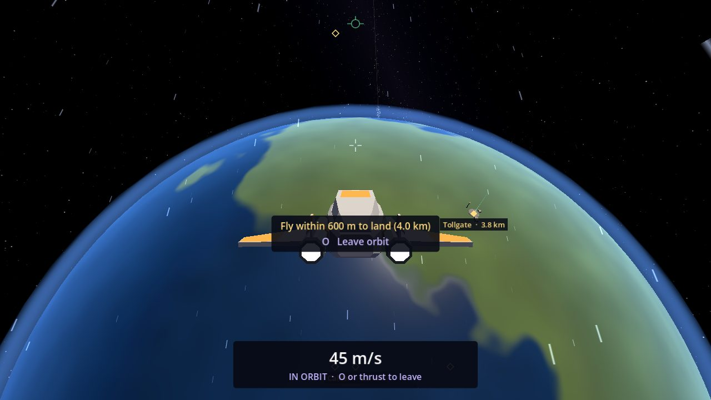

# Orbit

You can park in orbit round the planet Calder or its moon Mote and stay there as long as you like, with the world
turning slowly below you. It is a simple, relaxing mode: nothing ever falls out of orbit.

## The orbit line

Each planet and moon has one orbit, a circle up in space: **3 km above Calder** and **1.2 km above Mote**. Getting
there is like a launch: you climb up to the line and turn along it.

Once you're up off the ground (from a quarter of the orbit's height, so not while taking off or landing), the game
shows you the way:

- **The line itself:** a faint lane round the planet, in the plane you would go round in (the way you're heading).
- **The orbit ring on the HUD:** a small ring marking where you would join the line ahead, labelled with what to do,
  for example "Orbit · climb 1.2 km" or "descend". Fly at the ring for a gentle climb into orbit. When you're on the
  line it says "slow down" or "level out" until you can enter, then just "Orbit". If the ring is off the screen, it
  waits at the edge on the side to turn to.

## Entering orbit

1. Climb to the line, slower than 250 m/s and not climbing or diving too steeply.
2. Close to the line (within 600 m of it round Calder, 300 m round Mote) the HUD shows **O  Enter orbit**.
   Press **O**.
3. The ship swings onto the orbit with a firm push and settles onto the line's height, turning so the planet fills the
   bottom of the cockpit window. Moving the mouse stops that turn and leaves the view to you.

Pressing **O** anywhere else tells you what's wrong: "Climb 1.2 km to Calder's orbit line first" (or "Descend"), "Too
fast to enter orbit round Calder. Slow down first", or "Too steep to enter orbit round Calder. Level out first". Far
from any planet, or while the cruise drive is on, it says "Nothing to orbit here".

In orbit the ship goes round slowly at a steady height, and the view turns with it, so the planet stays in place while
the ground drifts past. The dashboard reads "IN ORBIT · O or thrust to leave". The orbit line and ring are hidden while
you're in orbit.

## Leaving orbit

- **O** again, or any thrust key, leaves gently: the ship carries on and its nose comes up level over a second or so
  ("Levelling out to leave orbit"), then flight assist takes over and you climb slowly away.
- **X** leaves and stops; **Z** leaves and drifts with flight assist off; starting the cruise drive leaves at once.
- A hard bump knocks you out of orbit ("Bump! Knocked out of orbit").

To land at Tollgate from orbit, leave orbit and fly down to the base: landing is offered within 600 m of its pad
([Docking and Landing](Docking-and-Landing#landing-at-tollgate)).

## Orbits

| Body | Orbit line | O offered | Orbit speed | Once round |
| --- | --- | --- | --- | --- |
| Calder | 3 km above the surface | 2.4 to 3.6 km up | 45 m/s | about 21 minutes |
| Mote | 1.2 km above the surface | 0.9 to 1.5 km up | 20 m/s | about 14 minutes |
